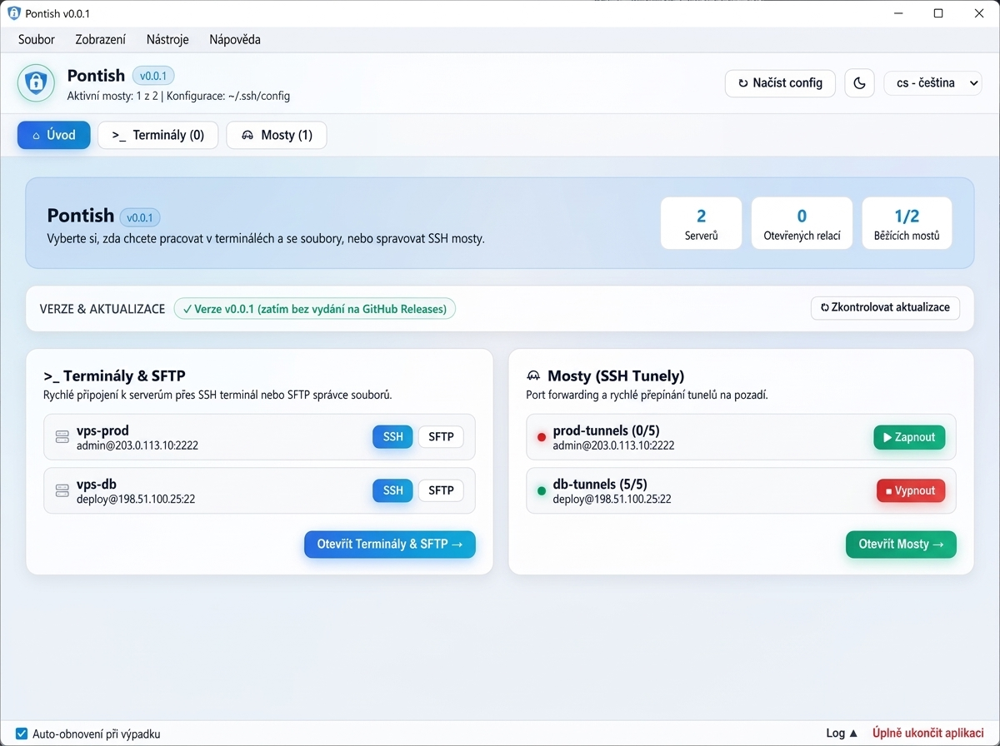
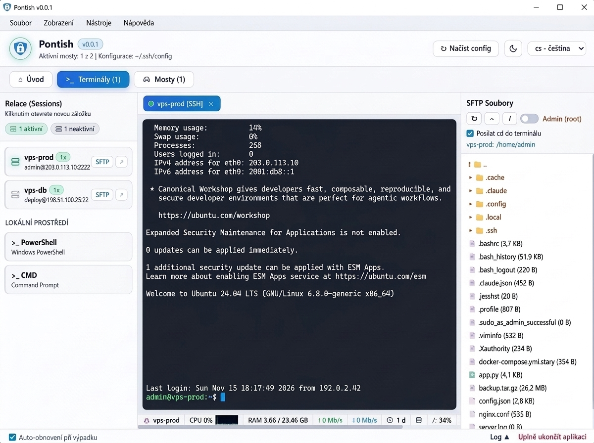
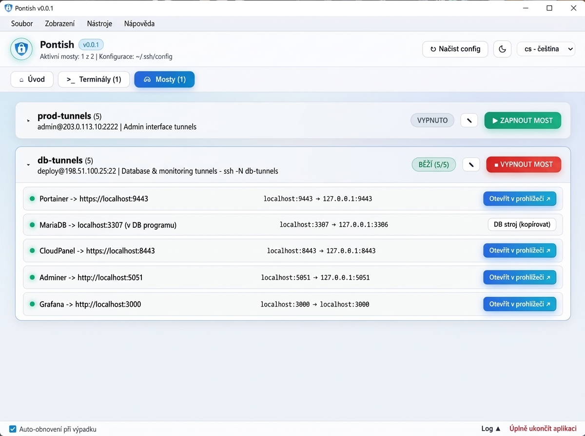

# Pontish 🌉

*🇨🇿 Česká dokumentace | 🇬🇧 [English documentation](README.md)*

**Pontish** je moderní, rychlý a bezpečný open-source správce **SSH terminálů, SFTP souborů a SSH mostů (port-forwarding tunelů)** pro Windows (postavený na **.NET 8 + WebView2 + ConPTY + xterm.js**).

Běží v oznamovací oblasti (System Tray), nabízí tmavé i světlé rozhraní, vestavěný vizuální editor `~/.ssh/config`, šifrované ukládání hesel i šifrované zálohování a automaticky hlídá a obnovuje tunely.

---

## 📸 Ukázky aplikace

| Úvodní přehled | Terminály & SFTP | Mosty (SSH tunely) |
| :---: | :---: | :---: |
|  |  |  |

---

## ✨ Hlavní funkce

### 🏠 Úvodní přehled (Dashboard)
* Rychlý přehled počtu serverů, aktivních terminálových relací a běžících SSH mostů.
* Spuštění SSH/SFTP, PowerShellu, CMD nebo přepnutí mostů na jedno kliknutí.
* Automatická kontrola nových verzí na GitHub Releases při spuštění (s možností stažení instalátoru).
* Pokud ještě nemáte soubor `~/.ssh/config`, zobrazí se tlačítko **+ Vytvořit ~/.ssh/config** s připraveným bezpečným výchozím nastavením (`Host *`).

### `>_` Integrované Terminály & SFTP správce
* **Vestavěný ConPTY terminál (`xterm.js`):** Plnohodnotná podpora barev, interaktivních nástrojů (`htop`, `nano`, `vim`), zkráceného `Ctrl+C` / `Ctrl+V` a kontextového vkládání.
* **Místní shell:** PowerShell i CMD přímo v panelech vedle SSH relací.
* **3-stavové indikátory připojení** (na kartách terminálů i v seznamu relací): šedá (odpojeno), blikající oranžová (připojuje se / čeká na heslo), zelená (přihlášeno).
* **SFTP prohlížeč & správce souborů:** Stromové procházení vzdálených složek, synchronizace aktuální složky s terminálem, nahrávání/stahování, vytváření složek a možnost **Režim správce (`sudo`)**.
* **Živý monitoring serveru:** CPU graf, RAM, síťový provoz a využití disků pro aktivní SSH relaci.

### 🌉 SSH Mosty (Port-Forwarding tunely)
* Přehledné karty mostů seskupené podle komentářů v `~/.ssh/config` s živou detekcí naslouchajících portů.
* **Auto-reconnect:** Automaticky hlídá spojení a při výpadku sítě nebo probuzení PC tunely znovu naváže.
* **System Tray:** Stavová ikona u hodin s kontextovým menu pro rychlé zapnutí/vypnutí jednotlivých mostů.

### ⚙ Vizuální editor `~/.ssh/config` & Windows Menu
* Rozdělený přehled na **SSH servery** a **Tunely / Mosty** s možností přidávat, upravovat, mazat, převádět SSH server na most a vybírat privátní klíče.
* Horní **Windows menu lišta** (`Soubor`, `Zobrazení`, `Nástroje`, `Nápověda`) včetně klávesové zkratky **`F1`** pro rychlou nápovědu a dialogu *O aplikaci*.
* Přepínání **tmavého / světlého motivu** a jazyka (**čeština / angličtina**).

### 🔐 Zabezpečení hesel a zálohování
* **Tichá autentizace (`SSH_ASKPASS`):** Bezpečné předávání hesel přes pomocný `askpass.exe` bez vyskakovacích oken.
* **Volitelný lokální trezor (`~/.ssh/pontish.vault`):** V menu *Nástroje → Ukládat hesla šifrovaně do ~/.ssh* můžete zapnout ukládání hesel (zašifrováno přes **Windows DPAPI** pro váš Windows účet + omezená NTFS práva). Volba *Zapomenout uložená hesla* vymaže paměť i soubor trezoru.
* **Přenositelný šifrovaný Export / Import (`.pontish`):** Záloha `~/.ssh/config`, SSH klíčů i uložených hesel chráněná vaším heslem pomocí **`AES-256-GCM`** a **`PBKDF2-SHA256` (200 000 iterací)** s automatickou opravou NTFS oprávnění po importu. (Zpětně podporuje i nešifrovaný `.zip` a holý `config`.)

---

## ⚙️ Konfigurace (`~/.ssh/config`)

Pontish čte i zapisuje standardní konfigurační soubor OpenSSH klienta: `C:\Users\<VášUživatel>\.ssh\config`.
Pokud ho ještě nemáte, můžete ho vytvořit přímo v aplikaci tlačítkem **+ Vytvořit ~/.ssh/config**, které vytvoří výchozí globální sekci:

```ssh-config
# Pontish SSH Config
Host *
    ServerAliveInterval 30
    TCPKeepAlive yes
    StrictHostKeyChecking accept-new
```

* Sekce `Host` s alespoň jedním `LocalForward` se zobrazují v sekci **Mosty** i v **Terminálech**.
* Sekce `Host` bez `LocalForward` se zobrazují jako **SSH servery**.
* Komentář `# === Název skupiny ===` nad `Host` vytvoří skupinu karet a komentář `# Popis -> URL` nad `LocalForward` vytvoří na kartě klikací odkaz.

---

## 🚀 Požadavky

* **Operační systém:** Windows 10 / 11 (64-bit)
* **OpenSSH Client:** Součást Windows (*Nastavení → Volitelné součásti → OpenSSH klient*)
* **WebView2 Runtime:** Součást Windows 11 (ve Windows 10 případně stažen automaticky)
* **.NET 8:** V Release instalátoru je obsažen jako *self-contained* (není třeba instalovat zvlášť); pro vývoj / build z kódu je potřeba **.NET 8 SDK**.

---

## 🛠️ Sestavení ze zdrojových kódů (Build)

Repozitář obsahuje čisté zdrojové kódy bez předkompilovaných binárek. Pro sestavení Release aplikace a instalátoru `Pontish-Setup.exe` spusťte v PowerShellu:

```powershell
powershell -ExecutionPolicy Bypass -File .\build.ps1
```

Skript provede:
1. Zkompilování `askpass.exe` z `askpass.cs`.
2. Publikaci `PontishApp.csproj` (`.NET 8`, `Release`, `win-x64`, self-contained).
3. Zabalení souborů do `PontishPayload.zip`.
4. Zkompilování GUI instalátoru `Pontish-Setup.exe` z `Installer.cs`.

---

## 📦 Instalace

1. Spusťte vygenerovaný soubor `Pontish-Setup.exe` (nebo si stáhněte nejnovější z GitHub Releases), případně rozbalte portable archiv `Pontish-win-x64.zip`.
2. Instalátor automaticky nainstaluje aplikaci do `%LOCALAPPDATA%\Programs\Pontish`, vytvoří zástupce na Ploše i v nabídce Start a ověří/opraví práva složky `~/.ssh/`.

> **Upozornění k antiviru a Windows SmartScreen:** Vydané soubory zatím nejsou digitálně podepsané. Windows SmartScreen (*Další informace → Přesto spustit*) nebo přísnější antiviry (např. Avast CyberCapture) proto mohou instalátor `Pontish-Setup.exe` dočasně zablokovat nebo zavřít do sandboxu. Pokud k tomu dojde, antivir na chvíli pozastavte po dobu instalace (případně přidejte výjimku pro `%LOCALAPPDATA%\Programs\Pontish`), nebo použijte portable archiv `Pontish-win-x64.zip`.

---

## 📄 Licence

Tento projekt je svobodný open-source software šířený pod licencí [MIT License](LICENSE).
