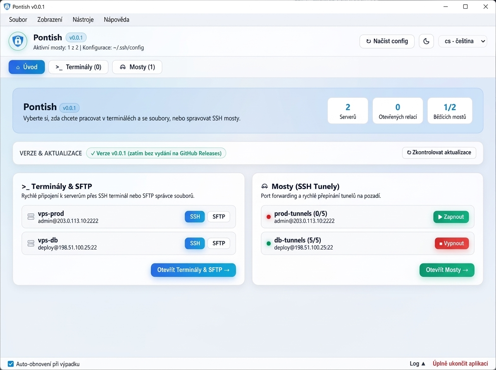
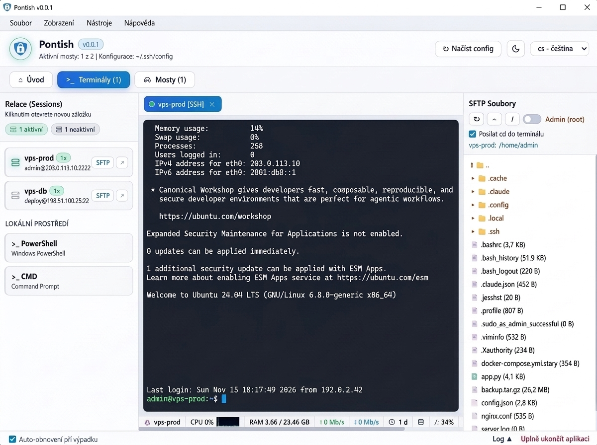
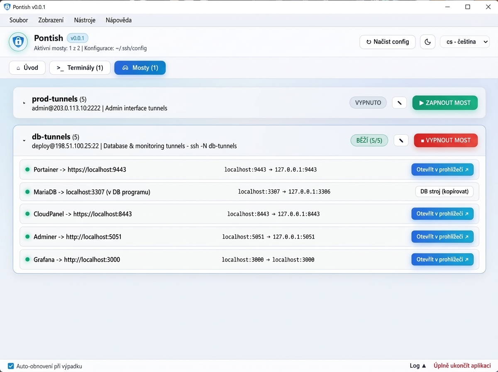

# Pontish 🌉

*🇬🇧 English documentation | 🇨🇿 [Česká verze (Czech)](README.cs.md)*

**Pontish** is a modern, lightweight, and secure open-source **SSH Terminal, SFTP Manager, and SSH Bridge (port-forwarding) tool** for Windows (built with **.NET 8 + WebView2 + ConPTY + xterm.js**).

It runs in your Windows System Tray, provides a dark/light UI, a built-in visual `~/.ssh/config` editor, encrypted password storage and encrypted backups, and monitors/reconnects your tunnels automatically.

---

## 📸 Screenshots

| Home Dashboard | Terminals & SFTP | SSH Bridges |
| :---: | :---: | :---: |
|  |  |  |

---

## ✨ Features

### 🏠 Home Dashboard
* Quick overview of configured servers, active terminal sessions, and running SSH bridges.
* One-click launch for SSH/SFTP sessions, local PowerShell/CMD, or bridge toggles.
* Automatic startup check for new releases on GitHub Releases (with direct installer download link).
* If `~/.ssh/config` does not exist yet, a **+ Create ~/.ssh/config** button creates it with sensible `Host *` defaults.

### `>_` Integrated Terminals & SFTP File Manager
* **Built-in ConPTY Terminal (`xterm.js`):** Full color support, interactive CLI apps (`htop`, `nano`, `vim`), clipboard paste, and local PowerShell / CMD tabs.
* **3-state connection indicators** on terminal tabs and the sessions list: gray (idle), pulsing orange (connecting / waiting for password), green (authenticated).
* **SFTP Tree & File Manager:** Browse remote directories, auto-sync current working directory with the terminal, upload/download/mkdir/delete, and optional **Admin (`sudo`) mode**.
* **Live Server SysStats:** Real-time CPU graph, RAM usage, network throughput, and disk usage for the active SSH session.

### 🌉 SSH Bridges (Port-Forwarding Tunnels)
* Clean bridge cards grouped by comments in `~/.ssh/config` with live local port listening status.
* **Auto-Reconnect Engine:** Monitors tunnels and automatically restores them after network drops or PC sleep/wake.
* **System Tray Resident:** Status tray icon with quick toggle controls directly from the tray menu.

### ⚙ Visual `~/.ssh/config` Editor & Windows Menu Bar
* Split into **SSH Servers** and **Tunnels / Bridges** — add, edit, delete entries, convert an SSH server into a bridge, or browse for private keys.
* Native-style **Windows menu bar** (`File`, `View`, `Tools`, `Help`) including **`F1`** Quick Help and *About* dialog.
* Instant **Dark / Light theme** and **Czech / English** language switching.

### 🔐 Password Security & Encrypted Backups
* **Silent Authentication (`SSH_ASKPASS`):** Passes credentials securely via `askpass.exe` without console popups.
* **Optional Local Vault (`~/.ssh/pontish.vault`):** Enable *Tools → Save passwords encrypted in ~/.ssh* to persist passwords encrypted with **Windows DPAPI** (`CurrentUser`) and restricted NTFS permissions. *Forget saved passwords* clears both memory and the vault file.
* **Portable Encrypted Export / Import (`.pontish`):** Back up `~/.ssh/config`, SSH keys, and saved passwords encrypted with your password using **`AES-256-GCM`** + **`PBKDF2-SHA256` (200,000 iterations)**, with automatic NTFS permission repair on import. (Also supports legacy `.zip` and raw `config` files.)

---

## ⚙️ Configuration (`~/.ssh/config`)

Pontish reads and writes your standard OpenSSH client configuration at `C:\Users\<YourUsername>\.ssh\config`.
If it does not exist yet, click **+ Create ~/.ssh/config** in the app to initialize it with:

```ssh-config
# Pontish SSH Config
Host *
    ServerAliveInterval 30
    TCPKeepAlive yes
    StrictHostKeyChecking accept-new
```

* `Host` entries with at least one `LocalForward` appear in both **Bridges** and **Terminals**.
* `Host` entries without `LocalForward` appear as **SSH Servers**.
* `# === Group Name ===` above a `Host` groups cards visually, and `# Label -> URL` above a `LocalForward` renders a clickable link on the bridge card.

---

## 🚀 Requirements

* **OS:** Windows 10 / 11 (64-bit)
* **OpenSSH Client:** Windows built-in feature (*Settings → Optional features → OpenSSH Client*)
* **WebView2 Runtime:** Built into Windows 11 (auto-installed if needed on Windows 10)
* **.NET 8:** Bundled self-contained in the release installer; **.NET 8 SDK** is required when building from source.

---

## 🛠️ Building from Source

The repository contains pure readable source code with zero precompiled binaries. To build the Release application and `Pontish-Setup.exe` installer, run in PowerShell:

```powershell
powershell -ExecutionPolicy Bypass -File .\build.ps1
```

The script will:
1. Compile `askpass.exe` from `askpass.cs`.
2. Publish `PontishApp.csproj` (`.NET 8`, `Release`, `win-x64`, self-contained).
3. Package the application payload into `PontishPayload.zip`.
4. Compile the GUI installer `Pontish-Setup.exe` from `Installer.cs`.

---

## 📦 Installation

1. Run `Pontish-Setup.exe` (built locally or downloaded from GitHub Releases), or extract the portable `Pontish-win-x64.zip` archive.
2. The installer deploys Pontish to `%LOCALAPPDATA%\Programs\Pontish`, creates Desktop and Start Menu shortcuts, and verifies/repairs `~/.ssh/` NTFS permissions.

> **Note on Windows SmartScreen & Antivirus:** Because the release binaries are currently unsigned, Windows SmartScreen (*More info → Run anyway*) or strict antivirus shields (such as Avast CyberCapture) may temporarily block or sandbox `Pontish-Setup.exe`. If this happens, temporarily pause your antivirus during installation (or add an exception for `%LOCALAPPDATA%\Programs\Pontish`), or use the portable `Pontish-win-x64.zip` archive instead.

---

## 📄 License

This project is open-source software licensed under the [MIT License](LICENSE).
